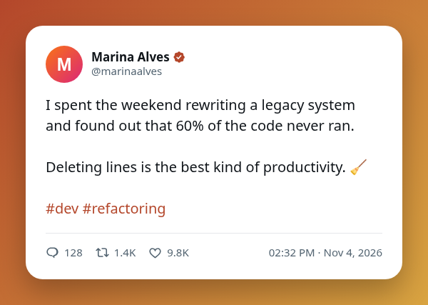
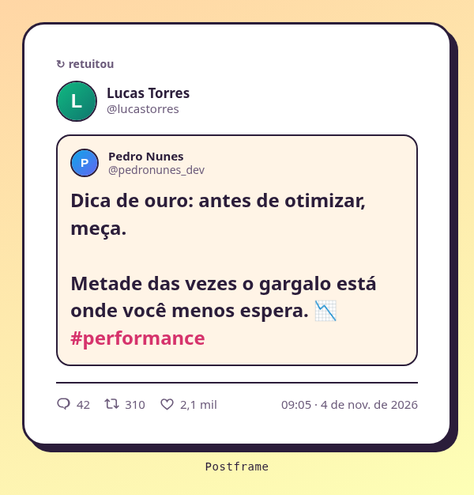

# Postframe

Extensão do Chrome que transforma um post (**X, Bluesky, Reddit, Instagram** ou qualquer site que você configurar) em uma **imagem padronizada**: foto, nome, @, texto completo, imagens em mosaico, contagens e hora, dentro de um estilo que você controla.

A imagem não é um recorte da tela: ela é **montada a partir dos dados do post**, então sai sempre com 600 px de largura e até 350 KB, com a mesma aparência.

> ⚠️ **Versão beta.** O Postframe está em desenvolvimento ativo. Pode haver bugs, e os sites mudam o HTML com frequência, o que pode quebrar a leitura dos posts. Só o **X.com** foi testado e está OK; veja o [checklist de plataformas](#plataformas).

| Claro clássico | Moldura gradiente | Pôster pastel (retweet) |
|---|---|---|
|  |  |  |

## Recursos

- **Dados do post:** foto, nome, @, texto completo, hora e contagens (respostas, RTs, curtidas…). Em retweets e citações, o tweet original aparece dentro do card.
- **Imagens do post em mosaico** (1, 2, 3 ou 4), com opção de escondê-las.
- **6 estilos prontos e estilos próprios:** fonte, cores, cartão, bordas, sombra e brilho, moldura em gradiente, formato da foto, faixa no topo e mais. Duplique qualquer estilo e edite.
- **Google Fonts:** escolha uma fonte da lista ou digite qualquer família do Google Fonts.
- **Marca d'água** de texto ou imagem, posicionável por arraste, com inclinação e opção de **repetir em padrão de tijolos** com espaçamento ajustável.
- **Crédito** opcional abaixo da imagem.
- **Estilos por plataforma:** o estilo do X pode ser diferente do de outro site, e dá para duplicar um estilo e trocar a plataforma dele. O padrão também é por plataforma.
- **Qualquer site:** uma ferramenta de seleção deixa você clicar em post, nome, @, foto, texto, imagens, hora e contagens. A configuração fica salva por site.
- **Exportar e importar** estilos e plataformas em JSON.
- Liga/desliga rápido de **Crédito**, **Marca d'água** e **Imagens** na página de resultado.

## Plataformas

### Checklist de suporte (beta)

Só o X.com foi testado e está OK. As demais plataformas estão implementadas, mas ainda não foram validadas.

- **X.com**
  - [x] Testada
  - [x] OK
- **Bluesky**
  - [ ] Testada
  - [ ] OK
- **Reddit**
  - [ ] Testada
  - [ ] OK
- **Instagram**
  - [ ] Testada
  - [ ] OK
- **Qualquer outro site** (ferramenta de seleção)
  - [ ] Testada
  - [ ] OK

### O que cada plataforma lê

| Plataforma | Status | Posts | Imagens | Contagens | Repost / citação |
|---|---|---|---|---|---|
| **X** | testada e OK | ✅ | ✅ (e capa de vídeo) | ✅ | ✅ repost e citação |
| **Bluesky** | beta, ainda sem validação | ✅ | ✅ | ✅ | ✅ repost · ❌ citação |
| **Instagram** | **beta**: extrator por heurística, ainda sem validação | ✅ | ✅ | ❌ (não estão no DOM) | — |
| **Reddit** | **beta**, ainda sem validação | ✅ | ✅ | ✅ | — |
| **Qualquer site** | beta, ainda sem validação | ✅ | ✅ | ✅ | ❌ |

- **Beta** significa que o site pode mudar ou que há casos que ainda não cobrimos. Se algo falhar, use **Reconfigurar este site** no próprio site: a sua configuração tem precedência sobre a embutida.
- No **Instagram**, o DOM não tem ganchos estáveis (sem `<header>`, classes ofuscadas), então a legenda é "o maior texto fora de links e botões" e posts patrocinados podem sair sem hora. Vídeos sem capa saem sem imagem.
- O **Reddit** foi escrito a partir dos atributos documentados do `<shreddit-post>`, sem página real (o Reddit bloqueia navegador automatizado). Se você tiver o Reddit logado, a seção "Ajude a validar o Reddit" abaixo leva um minuto.
- Só o **X** tem o botão de câmera dentro do post. Nas demais, clique no ícone da extensão e use **Capturar um post**.

## Instalação (modo desenvolvedor)

1. Baixe ou clone este repositório.
2. Abra `chrome://extensions` e ative o **modo do desenvolvedor**.
3. Clique em **Carregar sem compactação** e escolha a pasta do projeto.

## Como usar

**No X:** passe o mouse em um tweet e clique no ícone de câmera na barra de ações. Uma nova aba abre com as imagens nos estilos disponíveis (começando pelo padrão). Baixe ou copie a que preferir.

**Bluesky, Reddit, Instagram:** abra o site, clique no ícone da extensão, escolha **Capturar um post** e clique no post desejado.

**Em outro site:** abra o site, clique no ícone da extensão e escolha **Configurar este site**. Clique em um post inteiro e depois nos campos que quiser (nome, texto, imagens…). Salve e use **Capturar um post**.

**Estilos e plataformas:** botão direito no ícone → *Opções* (ou **Estilos…** na página de resultado).

## Privacidade e permissões

- Os estilos, plataformas e preferências ficam em `chrome.storage.local`, no seu navegador. Não há contas, servidor próprio nem análise de uso.
- A extensão acessa a rede apenas para:
  - **Google Fonts** (`fonts.googleapis.com`, `fonts.gstatic.com`), quando você usa uma fonte do Google, para baixar a fonte;
  - **CDNs de imagem** (`pbs.twimg.com`, `cdn.bsky.app`, `*.cdninstagram.com`, `*.fbcdn.net`, `i.redd.it`, `preview.redd.it`, `external-preview.redd.it`), apenas quando o site bloqueia o download direto das imagens do post e das fotos de perfil que entram na imagem.
- `storage`: guardar suas configurações. `activeTab` e `scripting`: abrir o painel de captura/configuração só na aba em que você clica no ícone (a extensão não tem acesso permanente a todos os sites). Os scripts automáticos rodam apenas em `x.com` e `twitter.com`.

## Limitações

- Os sites mudam o HTML com frequência: os seletores embutidos podem quebrar (veja **Plataformas**).
- Em sites configurados pelo seletor, fotos bloqueadas por CORS aparecem como um avatar com a inicial, e imagens bloqueadas ficam de fora.
- Vídeos aparecem só como a capa. O seletor não enxerga shadow DOM fechado nem iframes de outro domínio.
- Postframe não é afiliado ao X Corp. "X" e "Twitter" são marcas de seus donos.

## Ajude a validar o Reddit

Em uma página do Reddit (logado ou não), abra o console do navegador (F12) e rode o código abaixo. Ele copia **só a estrutura** (nomes de atributos e contagens), sem texto nem links. Cole o resultado em uma issue.

```js
const p = document.querySelector('shreddit-post');
copy(JSON.stringify({
  posts: document.querySelectorAll('shreddit-post').length,
  atributos: p && p.getAttributeNames(),
  slots: p && [...p.querySelectorAll('[slot]')].map(e => e.getAttribute('slot')),
  imagens: p && p.querySelectorAll('[slot="post-media-container"] img').length
}));
```

## Desenvolvimento

O código é JavaScript puro (Manifest V3), sem etapa de build.

```
manifest.json
src/            background, scripts de conteúdo, painel de seleção e módulos compartilhados
options/        página de estilos e plataformas
viewer/         página que gera e mostra as imagens
mockups/        galeria de exemplos dos estilos nativos
```

Para regenerar a galeria (`mockups/`):

```sh
npm install
npx playwright-core install chromium
npm run mockups
```

## Licença

[MIT](LICENSE)
